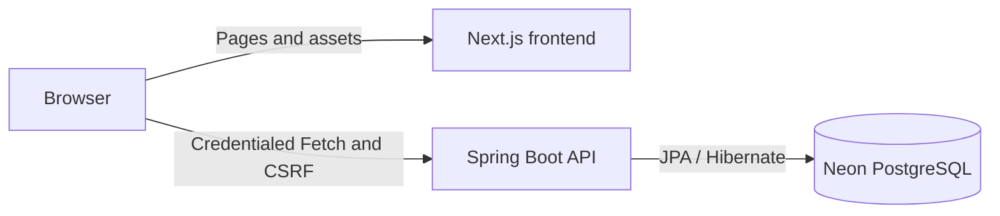

# Personal Styling & Outfit Recommendation Application

A full-stack application being developed to help people organize their clothing and choose practical outfits from their own wardrobe. The intended recommendations consider the occasion, location, time, weather, activities, transportation, and personal style, comfort, and modesty preferences.

This individual software engineering portfolio project covers requirements engineering, architecture, Java backend development, React frontend development, testing, and planned AI-assisted explanations.

**Current status:** Phase 0 (setup), Phase 1 (authentication), and Phase 2 (onboarding and styling profiles) are implemented. Wardrobe management and outfit recommendations are not implemented yet.

## Problem and objectives

Choosing an outfit involves more than matching clothes: the weather, walking or travel plans, event expectations, and personal preferences can change what is suitable. A useful styling assistant also needs to work with clothing the user actually owns.

The application aims to:

- Maintain a usable digital wardrobe and an editable styling profile.
- Turn explicit preferences and practical context into suitable outfit candidates.
- Explain why an outfit was suggested, including when the wardrobe cannot satisfy a request.
- Let users save looks and provide feedback for later personalization.
- Start with transparent, deterministic filtering and ranking; use optional AI assistance where it adds value.

## Features

### Implemented

- Responsive fashion/editorial landing page and shared Register/Login layouts with reversible panel animation and reduced-motion support.
- Registration with Jakarta validation, normalized email, duplicate-email protection, and BCrypt password hashing. Both registration and login enforce the 72-byte UTF-8 password boundary without changing password contents.
- Spring Security session login, current-account lookup, and logout, with safe account responses and centralized JSON errors.
- Session ID rotation, CSRF bootstrap/refresh, exact-origin credentialed CORS, and environment-aware cookie configuration.
- Typed frontend Fetch integration, session restoration, loading/error states, and protection against stale asynchronous authentication results.
- A minimal protected `/dashboard` showing account information, Sign out, and Start/Resume/Edit preference links.
- Accessible five-step `/onboarding` with optional answers, explicit No preference, draft saving, resume, skip, and completion; original four-step records remain compatible.
- `/profile` preference editing with read-only account identity, server-supported choices, and conflict/error recovery.
- Owner-bound relational profile persistence, optimistic version checks, and authenticated profile APIs.
- Optional Personal Details & Fit editor: height/sizing, self-described proportions, complexion/color, hair, and face shape; individual clearing and independent versioned deletion. No age, weight, birth date, or photographs are collected.
- Backend unit/MVC/PostgreSQL/HTTP tests, frontend helper/browser tests, and a separate opt-in live browser suite.

### Planned

- Digital wardrobe entry, editing, availability, search, and image handling.
- Occasion planning with location, date/time, weather, activities, and transportation context.
- Context-aware outfit composition, deterministic ranking, and grounded explanations.
- Saved outfits, feedback, and optional AI-assisted explanation wording.

Forgot Password is currently an explicitly unavailable UI; no reset email is sent. Google/Apple authentication is disabled. Landing categories such as Makeup and Hair are presentational, and their recommendation scope remains undecided. See the [SRS](docs/requirements/SRS.md) for priorities, acceptance criteria, and unresolved decisions.

## Technology stack

| Area | Current technology |
| --- | --- |
| Frontend | Next.js 16.3.5 App Router, React 19.2.8, TypeScript |
| Styling | Tailwind CSS v4, shadcn/ui with Base UI, CSS modules |
| Backend | Java 21, Spring Boot 4.1.1, Spring Security 7.1.1 |
| Persistence | Spring Data JPA, Hibernate, PostgreSQL hosted on Neon |
| Authentication | Server-side HTTP sessions, BCrypt, Jakarta Bean Validation |
| Testing | JUnit, Mockito, Spring MVC/servlet tests, Playwright |
| Build tools | pnpm 10.34.5; Maven Wrapper (Maven 3.9.16) |

Versions are taken from the repository manifests, wrapper configuration, and session-authentication documentation. No runtime weather or AI provider has been selected.

## High-level architecture



The frontend calls Spring Boot directly; there is no Next.js API proxy or second authentication system. The backend validates requests, verifies credentials, authorizes API access, and persists account/profile data. Frontend route guards control navigation; Spring Security is the actual authorization boundary.

Sessions are stored in backend memory, referenced by an HttpOnly cookie. The frontend restores identity through `/api/auth/me` and keeps its application authentication state in memory rather than localStorage. CSRF tokens are obtained from `/api/auth/csrf`, sent in `X-XSRF-TOKEN`, and refreshed after login/logout. Every API fetch includes `credentials: 'include'`.

| Endpoint | Purpose |
| --- | --- |
| `GET /api/auth/csrf` | Bootstrap the CSRF cookie/header token pair |
| `POST /api/auth/register` | Create an account; return 201 without automatically signing in |
| `POST /api/auth/login` | Authenticate and establish a session |
| `GET /api/auth/me` | Return the authenticated account's safe identity |
| `POST /api/auth/logout` | Invalidate the session; return 204 |
| `GET /api/profile/options` | Authenticated preference catalog |
| `GET /api/profile/me` | Current profile or NOT_STARTED; GET does not insert |
| `PUT /api/profile/me` | Atomic full snapshot SAVE/SKIP/COMPLETE with expected version |
| `GET /api/profile/appearance` | Optional personal details or empty snapshot; GET does not insert |
| `PUT /api/profile/appearance` | Replace nullable personal details with an expected UUID revision |
| `DELETE /api/profile/appearance` | Delete personal details only; expected revision in JSON body |

Authentication POSTs require CSRF. Full contracts and PowerShell examples are in the [backend session guide](apps/api/SESSION_AUTH.md).

Profile PUT and DELETE also require CSRF. Auth and profile clients share one request queue/token cache. Saves preserve unanswered versus explicit No preference and reject stale versions. Appearance and styling are separate resources; the onboarding UI discloses partial save success instead of claiming an atomic combined save. See the [profile API](docs/api/styling-profile.md) for validation, compatibility, ownership, and uncertain-write handling. No recommendation engine applies these preferences yet, and appearance data is not sent to AI or external services.

## Project structure

```text
.
├── apps/
│   ├── api/
│   │   ├── .mvn/wrapper/             # Maven distribution configuration
│   │   ├── src/main/java/com/chamodi/styling/
│   │   │   ├── auth/                 # DTOs, controller, service, persistence, security
│   │   │   ├── profile/              # Catalog, onboarding snapshots, persistence, API
│   │   │   └── common/               # Shared error response and exception handling
│   │   ├── src/main/resources/        # Development and production configuration
│   │   ├── src/test/java/            # Backend tests
│   │   ├── pom.xml
│   │   └── SESSION_AUTH.md
│   └── web/
│       ├── public/images/            # Local authentication and landing assets
│       ├── src/app/                  # App Router pages and layouts
│       │   ├── (auth)/               # Register, Login, Forgot Password
│       │   └── (app)/dashboard/      # Minimal authenticated account screen
│       ├── src/components/           # Shared auth, landing, and UI components
│       ├── src/lib/                  # Typed API client, validation, utilities
│       ├── tests/                    # Playwright helper and browser tests
│       └── README.md
├── docs/
│   ├── README.md
│   └── requirements/
│       ├── SRS.md
│       └── requirements-traceability.md
├── pnpm-lock.yaml
└── pnpm-workspace.yaml
```

The backend is built separately with Maven; it is not a pnpm package. App Router group names do not appear in URLs. The root page is `/`; the other implemented pages are `/register`, `/login`, `/forgot-password`, and `/dashboard`.

## Local development

### Prerequisites

- Java JDK 21, with `JAVA_HOME` and the Java executable configured.
- Node.js 20.9.0 or newer, matching the installed Next.js package's minimum.
- pnpm 10.34.5.
- Access to a development Neon PostgreSQL database and its connection settings.
- Internet access for initial dependency and Playwright browser downloads.

A separate Maven installation is unnecessary: use the included wrapper. Commands below use PowerShell and start from the repository root unless stated otherwise.

### Install frontend dependencies

```powershell
pnpm install --frozen-lockfile
```

### Configure and start the backend

In the first terminal, set the database environment variables for the backend process. The following values are placeholders only; replace them locally with your development connection details. Use the JDBC URL supplied for your Neon database and retain its required TLS parameters.

```powershell
Set-Location apps/api

$env:DB_URL = 'jdbc:postgresql://<database-host>:5432/<database-name>?sslmode=require'
$env:DB_USERNAME = '<database-username>'
$env:DB_PASSWORD = '<database-password>'

.\mvnw.cmd spring-boot:run
```

The API uses `http://localhost:8080` by default. Hibernate uses `ddl-auto=update` for development and manages `app_users`, `styling_profiles`, `styling_profile_answers`, and `styling_profile_choices`. Existing user constraints remain intact. Use a development database; this is not a production migration strategy.

Supply real secrets through your local environment or IDE configuration. Spring Boot is not configured to automatically load a root `.env.local` file; those variables must reach its process environment. Do not commit credentials or put them in frontend-public variables.

### Configure and start the frontend

Create `apps/web/.env.local` with this **nonsecret local setting**:

```dotenv
NEXT_PUBLIC_API_BASE_URL=http://localhost:8080
```

In a second terminal at the repository root:

```powershell
Set-Location apps/web
pnpm dev
```

Open `http://localhost:3000`. Register, sign in, then Start setup from Dashboard or edit `/profile`. Incomplete onboarding never blocks Dashboard. Password reset and social sign-in remain unavailable.

Use `localhost` consistently. The default backend CORS policy allows exactly `http://localhost:3000`; `127.0.0.1` or port 3001 will not match it. The API base URL must be an HTTP(S) origin without a path, query, credentials, or fragment. Next.js embeds this public setting at build time, so restart development or rebuild after changing it.

### Environment reference

| Variable | Used by | Purpose / local default |
| --- | --- | --- |
| `DB_URL` | Backend | Required PostgreSQL JDBC URL; use a local secret value |
| `DB_USERNAME` | Backend | Required database username; placeholder only in examples |
| `DB_PASSWORD` | Backend | Required database password; never expose to the frontend |
| `FRONTEND_ORIGIN` | Backend | Exact permitted browser origin; defaults to `http://localhost:3000` outside the production profile |
| `APP_COOKIE_SECURE` | Backend | Optional HTTPS cookie setting; defaults to `false` for local HTTP |
| `SPRING_PROFILES_ACTIVE` | Backend | Leave unset for default local configuration; use `prod` for the production HTTPS configuration |
| `NEXT_PUBLIC_API_BASE_URL` | Frontend | Public API origin; local value `http://localhost:8080` |

Environment files and generated artifacts are ignored by Git. Only public configuration belongs in `NEXT_PUBLIC_*` variables.

For production HTTPS, activate the backend `prod` profile and set an explicit `FRONTEND_ORIGIN`. That profile forces Secure cookies; local HTTP must retain non-Secure cookies. SameSite=Lax assumes same-site frontend/API hosting. Cross-site hosting needs a separately reviewed cookie arrangement. Current sessions have a 30-minute idle timeout and are lost when the backend restarts; shared-session deployment is not implemented.

## Automated checks and testing

### Backend

From `apps/api`, with the required database environment available to that terminal:

```powershell
.\mvnw.cmd test
```

The full suite includes an application-context test that needs database configuration. To run only the existing isolated authentication tests without Neon, use this explicit selection:

```powershell
.\mvnw.cmd '-Dtest=RegisterRequestTests,AuthServiceTests,AuthControllerTests,LoginRequestTests,RepositoryUserDetailsServiceTests,PasswordAuthenticationTests,SessionAuthenticationTests,SessionCookieTests' test
```

These tests cover validation, password matching, registration/duplicate handling, HTTP responses, sessions, CSRF, CORS, and cookies. Persistence is mocked for isolated tests; their success does not establish live database connectivity.

### Frontend

From `apps/web`:

```powershell
pnpm lint
pnpm typecheck
pnpm build
pnpm exec playwright install chromium
pnpm test
```

Playwright starts the production build on port 3000 by default. Set `$env:PLAYWRIGHT_PORT='3100'` to use another free port instead of stopping an existing server. Normal API responses are mocked, so this suite needs neither Spring Boot nor Neon. Desktop/mobile Chromium checks cover auth, onboarding/profile saves, errors, conflicts, session expiration, refresh, animation, and responsive behavior.

For helper tests without a browser or frontend server:

```powershell
pnpm test:unit
```

Mocked browser tests do not prove live cookie/CORS behavior. Use the separate [browser integration walkthrough](apps/web/README.md#manual-verification-with-spring-boot-and-neon) and [backend manual verification](apps/api/SESSION_AUTH.md#manual-verification-in-powershell) when testing against the running API and development database.

The [Phase 2 verification guide](docs/testing/phase-2-verification.md) documents isolated PostgreSQL test opt-in, the complete backend selection, the separate live browser config, actual results, and pending Neon checks. Live tests create synthetic rows only in a deliberately selected disposable database.

## Progress and roadmap

| Milestone | Status |
| --- | --- |
| Phase 0: project setup and database connection foundation | Complete |
| Phase 1A: landing and authentication UI | Complete |
| Phase 1B: backend registration and session authentication | Complete |
| Phase 1C: frontend–backend authentication integration | Complete |
| Whole-application SRS and traceability baseline | Documented; future requirements and open decisions await review |
| Phase 2: onboarding and styling profile management | Implemented; local PostgreSQL/live browser verified; Neon manual checks pending |
| Phase 2E: optional personal appearance and fit profile | Implemented; independent CRUD, five-step compatibility, local PostgreSQL/live browser verified; Neon/production HTTPS checks pending |

The next product path is a digital wardrobe, request context/weather, deterministic outfit recommendations and explanations, then saved outfits and feedback. Preference capture/editing is delivered; recommendation consumption is still planned. Priorities and release boundaries remain subject to the SRS decision log rather than assumed delivery dates.

## Documentation

- [Documentation index](docs/README.md)
- [Software Requirements Specification](docs/requirements/SRS.md)
- [Requirements traceability matrix](docs/requirements/requirements-traceability.md)
- [Frontend integration, setup, and testing](apps/web/README.md)
- [Backend session contracts, security configuration, and testing](apps/api/SESSION_AUTH.md)
- [Styling profile contracts](docs/api/styling-profile.md)
- [Phase 2 verification and manual walkthrough](docs/testing/phase-2-verification.md)
- [Development learning journal](docs/learning/LEARNINGS.md)

The SRS distinguishes implemented, planned, and clarification-dependent requirements. Its Phase 2 update preserves stable IDs and records the approved onboarding contract while leaving future engine/provider decisions open.

## Future direction

The next work should turn reviewed requirements into small, testable product slices while preserving the established authentication and UI. Recommendation development will begin with explicit filtering/ranking rules and grounded reasons, rather than requiring a model trained from scratch.

Optional AI wording, item recognition, conversational styling, calendar planning, history, and broader styling categories require separate scope and privacy decisions. Weather/AI providers, recommendation weights, media storage, retention policies, and performance targets have not been finalized. Open decisions are tracked in [SRS section 12](docs/requirements/SRS.md#12-open-decisions-and-assumptions).
